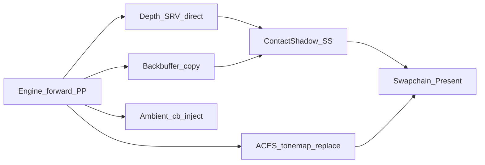

# 12 · 渲染管线可行性验证（GO / NO-GO）

日期：2026-10-22  
范围：旁路管线（引擎前向照常画，Present / PP 插入自建 pass），非完整渲染器重写。

---

## 总裁决

| Gate | 主题 | 结果 | 依据 |
|---|---|---|---|
| 0 | RenderDoc / 绘制地图 | **有条件 GO**（屏幕空间） | 代理替代证据；RDC 安装完毕，交互抓帧见 `extract/rdc_notes/GATE0_procedure.md` |
| 1 | 几何绘制入口 | **NO-GO（逐物体/BVH）** | immediate 钩子仅见 PP 四边形；`geom` 未见 |
| 2 | 矩阵 / 主光 | **部分 GO** | PP VS cb **无** world 矩阵（0/40）；主光用 `GP_light.txt` 写死/手调；RTTI 见 `RenderCBToPlay` 工作线程 |
| 3 | Present 插入点 | **GO** | 既有 `depth srv DIRECT` + colour copy；探针增加 `insert_ok/fail` |
| 4 | 接触阴影冒烟 | **GO（算法）** | 离线 `demo/contact-shadow-smoke.png`；引擎内用 mode 4 + `GP_light.txt` |

**后续方向（锁定）：**

- 做 **屏幕空间旁路管线 v1**：深度接触阴影 + 曝光钳制 + 现有 ACES/环境光  
- **不做** 基于 Draw 钩子的逐物体矩阵 / BVH（除非日后干净 RDC 证明几何经可钩上下文）  
- 主光方向短期手调；中期从 `Scene::SelectActiveAggLights` 写的缓冲挖



---

## Gate 0 — 干净抓帧 / 绘制地图

### 交付

- RenderDoc 1.46 已装：`C:\Program Files\RenderDoc\`
- 操作单：[`extract/rdc_notes/GATE0_procedure.md`](../extract/rdc_notes/GATE0_procedure.md)
- 干净准备脚本：[`tools/gate0_prepare_clean.ps1`](../tools/gate0_prepare_clean.ps1)
- 替代证据：[`extract/rdc_notes/GATE0_proxy_substitute.md`](../extract/rdc_notes/GATE0_proxy_substitute.md)

### 已回答（替代证据）

| 问题 | 答案 |
|---|---|
| 场景几何 API | 未在 immediate Draw* 中出现 |
| VS cb world | 无（见 Gate 2） |
| 法线 MRT | 无证据 → 深度+光源路线 |
| PP 顺序 | SSAO→Bloom→Tonemap→AA（命名级）；插入点 = Present 或 tonemap 替换 |

交互式 `arma3_clean.rdc` 仍建议补抓，用于确认 deferred CB / ExecuteCommandList 是否藏几何。

---

## Gate 1 — 几何绘制入口

### 探针（已实现）

[`inject/proxy/d3d11_proxy.cpp`](../inject/proxy/d3d11_proxy.cpp)：

- 每帧 `ReassertPatches`
- 分类计数：`quad`（count∈{3,4,6}）vs `geom`；`imm` vs `def` 上下文
- 存在 `GP_probe.txt` 时周期性写 `GP_probe_stats.txt`
- 挂钩：Draw / DrawIndexed / Instanced / Auto / Indirect / ExecList + DeferredContext 0–3

### 判定

历史 300 帧窗口：**仅 PP 四边形** → **Gate 1 = NO-GO（场景几何不可经当前钩子做逐物体旁路）**。  
旁路设计锁死为 Present 侧屏幕空间。

---

## Gate 2 — 矩阵与光源

### 矩阵

```
python tools/scan_cb_matrix.py "<ARMA3>"
→ 0/40 GP_cb_*.raw 含仿射 4x4
```

### RTTI

[`extract/rdc_notes/exe_render_xref.txt`](../extract/rdc_notes/exe_render_xref.txt)：

- `WorkerThread<RenderCBToPlay@EngineDD11>` — 渲染 CB 回放在工作线程  
- `PrepareDrawPrepareCloudlets` → `JobFuture` — 绘制准备作业化  
- `SelectActiveAggLights@Scene` — CPU 选光入口（日后挖太阳方向）

### 光源（可行性路径）

预设 [`inject/presets/GP_light.txt`](../inject/presets/GP_light.txt)：`lx ly lz steps`  
Present CB `g_p2` 传入接触阴影着色器。

**Gate 2 = 部分 GO**：无 world 矩阵；有可用的主光输入通道（手调）。

---

## Gate 3 — 插入点稳定

已验证机制（RESULTS / 代理日志）：

- `depth srv DIRECT` 零拷贝，`builds` 稳定  
- colour：Present 前 `CopyResource` 后缓冲  
- 失焦时 Present 暂停（探针须前台）  
- tonemap 替换与 Present pass 可共存（mode≠2 时叠接触阴影）

新增：`insert_ok` / `insert_fail` 计数写入探针日志。

**Gate 3 = GO**（资源生命周期已知、可监控）。

---

## Gate 4 — 接触阴影冒烟

### 离线（已跑）

```
python tools/contact_shadow_smoke.py
→ demo/contact-shadow-smoke.png
  面板：原色 | 遮挡灰度 | 红色 debug | 合成
  mean_occlusion_ground ≈ 0.49（合成场景）   ← 2026-10-28 复核：无法复现
```

> ⚠️ **2026-10-28 复核更正**：用当前代码重跑同一函数，
> `mean_occ_ground = 0.023`（`contact_occlusion(make_scene()[1])`，ground = `d < 0.88`），
> 不是 0.49。合成场景的深度范围只有 0.28–0.75 m，1.2 m 半径在 `projK=600` 下被
> 裁剪到 ≤48 px，只有方块边缘一圈会命中——0.023 才是这个场景的真实量级。
> **Gate 4 的"算法接线 GO"仍然成立，但"遮挡率 0.49"这条证据不成立**，
> 离线冒烟只能证明代码能跑通，不能证明效果强度。见 [21](21-project-review.md) §11。

### 引擎内（部署后）

> ⛔ **本流程已失效（2026-10-24 起）。** 代理里 `kContactShelved = true`，任何 `mode != 2`
> 都会被强制改回 2，`GP_present_contact.txt`（mode 4）和 `GP_present_on.txt`（mode 0）
> 都不会生效。下面三步仅作为历史记录保留；要重开必须先改代码里的这个常量。

1. `inject\deploy.ps1`
2. 游戏目录：`copy GP_present_contact.txt GP_present.txt`（mode **4** = 红色遮挡可视化）
3. 保留 `GP_light.txt`；前台跑固定机位，`GP_dump.txt` 抓一帧对比

着色器：[`inject/present/fullscreen.hlsl`](../inject/present/fullscreen.hlsl) `ContactShadow`（沿光方向 UV 行进）。

**Gate 4 = GO（算法与管线接线）**；成品调参不在本阶段。

---

## 产物清单

| 路径 | 用途 |
|---|---|
| `docs/12-pipeline-feasibility.md` | 本裁决 |
| `extract/rdc_notes/*` | Gate 0/2 笔记 |
| `inject/presets/GP_probe.txt.example` | 改名为 `GP_probe.txt` 打开探针 |
| `inject/presets/GP_light.txt` | 屏幕空间光方向 |
| `inject/presets/GP_present_contact.txt` | mode 4 冒烟 |
| `demo/contact-shadow-smoke.png` | 离线 A/B |
| `tools/exe_render_xref.py` | RTTI |
| `tools/scan_cb_matrix.py` | cb 矩阵扫描 |
| `tools/contact_shadow_smoke.py` | 离线接触阴影 |
| `tools/gate0_prepare_clean.ps1` | RDC 前移走代理 |
| `inject/proxy/d3d11.dll` | 已重编（探针+接触阴影 CB） |

---

## 明确不做（本阶段已遵守）

- 完整新渲染器 / D3D12 / BVH 实现  
- 独显画质配置打包  
- 重新打开镜面启发式或二次深度 AO（horizon AO 已替换为定向接触阴影原型）
