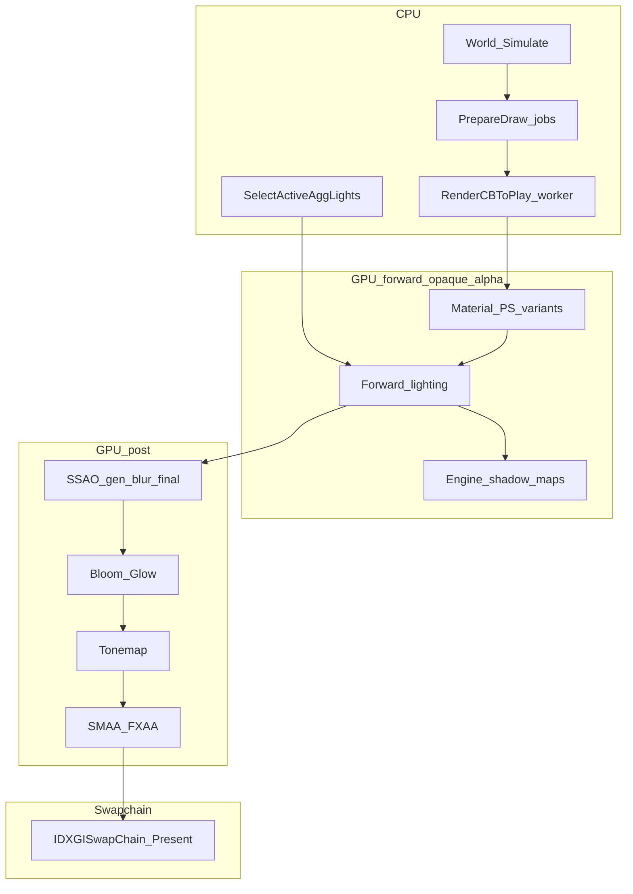

# 15 · 渲染管线与注入点总图（探索任务 2026-10-24）

现场：Computer Use 确认 **仅 `arma3launcher` 在跑**，`arma3_x64` 未进局；任务栏可见 BattlEye / ARMA III。下列为仓库 + 代理日志 + Gate 文档的**已证合成**，非本次进局新抓帧。

引擎：Real Virtuality 4 · **D3D11 only** · 前向多 pass · 无私有渲染插件 API。

---

## 1. 管线鸟瞰（已证）

| 段 | 证据 | 注入可达？ |
|---|---|---|
| 场景几何 Draw | immediate 钩子仅见 PP 四边形；几何疑走 deferred CB / 工作线程 | **NO-GO**（逐物体） |
| 材质 PS + CB size **224** | Unmap 改 AE / Diffuse / Specular / AmbientMid | **GO** |
| 主光方向 | PP VS cb 无 world；手调 / 待 CB hunt | **部分** |
| SSAO Final | CreatePS 指纹替换 | **GO** |
| Tonemap | size=5860 crc=42670B06 → ACES | **GO** |
| PSCB_PostProcess expo | size=1696 + 邻槽指纹 → f150 | **GO** |
| Present + 深度 SRV | depth srv DIRECT；接触影已 **搁置** | Present **GO** / CS **SHELVED** |
| G-buffer 法线 / 干净深度 | N1/N2 全帧普查 | **NO-GO** |

命名级 PP 顺序（`.shdc` + 替换验证）：  
`SSAO → Bloom → Tonemap → AA`；旁路插入点 = **Tonemap 替换** 或 **Present 前**。

---

## 2. 已挂钩注入点（`d3d11_proxy.cpp`）

| API / 槽 | 作用 | 出货状态 |
|---|---|---|
| `D3D11CreateDevice*` | 装设备/上下文/交换链钩 | 必需 |
| `CreatePixelShader` | tonemap / SSAOFinal 按 size+crc 或反汇编指纹替换 | ✅ |
| `Map` / `Unmap` | 材质 224；曝光 1696+指纹；可选 CB dump / light bind | ✅ |
| `OMSetRenderTargets` | 深度候选、MRT 普查 | 探针 |
| `Draw*` / `ExecuteCommandList` / deferred ctx | 分类 PP vs geom；ReassertPatches | 探针 |
| `Present` | 颜色拷贝 +（搁置）接触影；热读 `GP_*.txt` | 接触影强制 mode 2 |

配置面（热或重启）：`GP_replace` / `GP_amb` / `GP_expo` / `GP_spec` / `GP_present*` / `GP_light*` / `GP_cb_dump`。

---

## 3. 「光 × 材质 → 颜色」相关槽位

### 3.1 材质 CB（224 B，每 draw）

| float 下标（约） | 字段 | 拟真用途 | 现状 |
|---|---|---|---|
| 4–6 | AE | 环境/自发光缩放 | amb 链路可乘 |
| 16–18 | Diffuse | 漫反射 | 可改，慎全局 |
| 24–27 | Specular RGB + power | 高光响应 | boost 仅 `spec>0`；`==0` 覆写已否决 |
| 36–38 | AmbientMid | 阴影区环境色 | 当前主「发暗发蓝」旋钮之一 |

限制：**每材质常数**，无半球梯度 / 无 per-pixel BRDF 改写。

### 3.2 后处理 CB（1696 B）

- 真身份指纹：`c37≈(1,0.30|0.09, AE, 1|0.75)` + `c1.w≈0.4545` + `c0≈0`
- 钳 `f150`（场景曝光乘子）— 风格化工具，**不是**材质着色

### 3.3 尚未钉死、值得继续挖

- `SelectActiveAggLights` 写出的光照 CB（太阳方向 / 色温 / 强度）
- 雾 / haze / 大气相关高频 CB（三情景 dump 差分）
- Bloom / SSAO gen 的 crc 匹配（已定位名，未稳定替换）

---

## 4. 能力分层（投入建议）

| 层 | 手段 | 对「像真的」 | 优先级 |
|---|---|---|---|
| L0 配置 | cfg / Profile SSAO·阴影·AF | 中 | 保持拉满 |
| L1 成像 | tonemap / expo / 全局色温 | 风格化，易假 | **做减法** |
| L2 材质常量 | 224 CB 选择性响应 | 中高（在边界内） | **主攻** |
| L3 光照 CB | Unmap dump + hunt | 高（若钉住太阳/环境） | **主攻** |
| L4 Present SS | 接触影等 | 结构光；已黑天搁置 | 暂停 |
| L5 资源 | rvmat / 贴图 addon | 最高官方路径 | 另线 |
| L6 几何/BVH | Draw 钩子 | NO-GO | 不做 |

---

## 5. 现场探索缺口（本次）

- [ ] 进局（建议 **无 BattlEye** 私服 / 单人）后开 `GP_cb_dump.txt`，采白天/黄昏/室内  
- [ ] `tools/cb_sun_hunt.py` 出 `GP_light_bind` 或新光照旋钮  
- [ ] 可选：RenderDoc 干净 `.rdc` 确认 deferred 几何是否藏在 ExecList（Gate 0 补完）  
- [ ] 材质层：`GP_spec_boost` A/B + AmbientMid 中性预设（已部分落地）

---

## 6. 一句话

**管线已摸清到「前向 + PP 链 + Present」；可稳注入的是 CreatePS 替换与 Unmap 常量。几何与法线封闭。拟真颜色应押在材质 224 + 光照 CB，而不是再堆 tonemap。**
